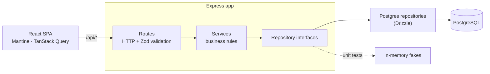

# ACME Salary Management

A web app for an HR manager to manage salary data for about 10,000 employees across 8 countries, and to answer one question that spreadsheets make hard: **how does the organisation pay people?**

**Live demo:** https://salary-management-pr23.onrender.com/. It runs on Render's free tier, so the first load after a period of inactivity can take up to a minute.


---

## What it does

**Employees**
- Search by name; filter by country and department; sort by name, salary or hire date
- Server-side pagination over 10,000 records
- Add, edit and delete employees, with validation shown next to each field

**Salary insights**
- Every country at a glance: headcount, median, average, lowest and highest salary, and the gap between average and median
- A page per country: pay by job title and salary spend by department

| Insights overview | Country breakdown |
|---|---|
|  |  |

## Key product decisions

- **Currencies are never mixed.** Salaries are stored and shown in each country's own currency (₹, $, €, ¥…). Every statistic is calculated within one country, and nothing is converted or added up across countries. Averaging rupees with dollars would give a meaningless number.
- **Median next to average.** A few very high salaries pull the average up but barely move the median. The "avg vs median" gap tells HR where pay is skewed.
- **Salary sorting needs a country.** Sorting ₹18,00,000 above $120,000 would be misleading, so the salary column only becomes sortable once a country is selected, and a tooltip explains why.
- **Filters live in the URL.** A filtered view such as `/employees?country=IN&department=Sales` can be bookmarked or shared, and the browser's Back button works.
- **Consistent data by design.** Countries are ISO codes and departments come from a fixed list, which avoids the "USA" / "U.S." / "United States" problem of spreadsheets. Currency is always derived from the country by the server; the client never sends it.

Scope, and what was deliberately left out (payroll, authentication, currency conversion, salary history, CSV import), is explained in **[docs/REQUIREMENTS.md](docs/REQUIREMENTS.md)**.

## Tech stack

| Layer | Choice |
|---|---|
| Backend | Node.js, TypeScript, Express 5, Zod |
| Database | PostgreSQL 16, Drizzle ORM (migrations with drizzle-kit) |
| Frontend | React 19, Vite, Mantine (components and charts), TanStack Query, React Router |
| Tests | Vitest, Supertest, Playwright |
| Hosting | Render (app) and Neon (Postgres) |
| CI | GitHub Actions |

## Architecture



- **Routes** handle HTTP only: they validate input with Zod and pass errors to one error handler, which maps them to `400`, `404` or `500`.
- **Services** hold the business rules, for example deriving the currency from the country (including when the country changes) and raising `NotFoundError`.
- **Repositories** sit behind an interface. Production uses Postgres; unit tests use an in-memory fake, so the business logic is tested without a database.
- **`server.ts`** is the one place where real dependencies are created and wired together. In production the same Express app also serves the built React app, so there is a single domain, no CORS setup, and one deployment.
- **Aggregation happens in SQL** (`GROUP BY`, `percentile_cont` for the median), so the API never loads 10,000 rows into memory.

```
backend/
  src/
    employees/      routes, validation, service, repository, countries
    insights/       routes, validation, service, repository
    seed/           deterministic generator + seed script
    db/  middleware/  config/
  drizzle/          SQL migrations
  tests/            unit, integration (real Postgres) and route tests
frontend/
  src/
    api/            fetch client, query hooks, types
    features/       employees/ and insights/ components
    pages/  lib/    pages, formatting and helpers (+ unit tests)
  e2e/              Playwright end-to-end tests
docs/               requirements, AI prompt log, performance notes
```

## Running locally

**You need** Node 24 (`nvm use` reads `.nvmrc`) and Docker.

```bash
# 1. Start Postgres (dev database on port 5434, test database on port 5433)
docker compose up -d

# 2. Backend: http://localhost:4000
cd backend
cp .env.example .env
npm ci
npx drizzle-kit migrate
npm run seed            # 10,000 employees, the same data every run
npm run dev

# 3. Frontend: http://localhost:5173 (in another terminal)
cd frontend
npm ci
npm run dev
```

## Tests

The project was built test-first, and each feature commit includes its tests.

| Suite | What it covers | Command | Count |
|---|---|---|---|
| Backend unit | Validation, services (with in-memory fakes), seed generator | `cd backend && npm test` | 105 in total |
| Backend integration | Repositories and SQL against a real Postgres: filters, search, sort ties, pagination, median, rounding, bigint totals | (same command) | |
| Backend routes | HTTP status codes, validation errors, 404s, serving the frontend | (same command) | |
| Frontend unit | Money formatting, URL parsing, form validation, API error mapping | `cd frontend && npm test` | 57 |
| End-to-end | Add, find, edit and delete an employee; form validation; filters surviving a reload; the salary-sort rule; insights navigation | `cd frontend && npm run test:e2e` | 7 |

- Unit tests are fast and need nothing running. Integration tests use the separate test database, which is reset before each test so results are always the same.
- End-to-end tests run in a real browser against the full stack. Each run uses uniquely named data and deletes it afterwards.
- **CI** ([`.github/workflows/ci.yml`](.github/workflows/ci.yml)) runs formatting, type checks, all three suites and the production build on every push.

## API

| Method | Path | Description |
|---|---|---|
| `GET` | `/api/employees` | List employees. Query: `search`, `country`, `department`, `jobTitle`, `sortBy` (`fullName`, `salary`, `hireDate`), `sortOrder`, `page`, `pageSize` (max 100) |
| `GET` | `/api/employees/:id` | Get one employee |
| `POST` | `/api/employees` | Create an employee. The currency is derived from the country |
| `PATCH` | `/api/employees/:id` | Update some fields. The currency is recalculated if the country changes |
| `DELETE` | `/api/employees/:id` | Delete an employee |
| `GET` | `/api/insights/countries` | Headcount, min, max, average and median per country |
| `GET` | `/api/insights/countries/:country` | One country: summary, pay by job title, spend by department |
| `GET` | `/health` | Health check |

Errors use one shape: `{ "error": "VALIDATION_ERROR", "issues": [{ "path": "salary", "message": "..." }] }`, `NOT_FOUND`, `INVALID_JSON` or `INTERNAL_ERROR`.

## Performance

Measured locally with 10,000 employees:

- **API responses take 3–10 ms**, covering the list, name search, deep pages and both insight endpoints.
- **Country filters and insights use the composite index** `(country, job_title)`. The same index also serves country-only queries (the leftmost-prefix rule), so no separate index is needed.
- **Name search** (`ILIKE '%…%'`) scans the table in about 9 ms. That's fine at this size; at millions of rows, a `pg_trgm` GIN index would make it index-backed.
- **The seed inserts 10,000 rows in about 0.6 s**, in 1,000-row chunks inside one transaction. A single 10,000-row insert would exceed Postgres's limit of 65,535 parameters per statement.

The `EXPLAIN ANALYZE` output is in **[docs/performance.md](docs/performance.md)**.

## Deployment

- **Render** builds the frontend and backend and runs one Node service ([`render.yaml`](render.yaml)). Express serves the API and the built React app; hashed assets are cached for a year.
- **Neon** hosts Postgres. Pending migrations run automatically when the server starts.
- `DATABASE_URL` is the only secret, and it's set in the Render dashboard.

## How AI was used

Claude was used as a pair programmer throughout: planning the requirements and architecture, explaining each database query in raw SQL before the Drizzle version, reviewing every step, and drafting parts of the code and tests. Each change was reviewed, run and adapted before committing. The tests and reviews caught several real issues along the way, for example a test that passed only because the table was empty, a lookup that always returned the first row, and a country check that accepted `"toString"`.

The log of prompts, what was accepted and what was changed is in **[docs/ai-prompts.md](docs/ai-prompts.md)**.

## Trade-offs and next steps

- **Authentication and roles:** left out because there is a single persona. It would be the first addition before real use.
- **Salary history and audit log:** needed for raises and for questions about pay over time.
- **CSV / Excel import:** HR's data lives in spreadsheets today, so this is the most likely next feature.
- **Currency conversion** using dated exchange rates, for organisation-wide totals.
- **Pay-outlier view:** employees paid well below or above the median for their role in their country.
- **Scaling:** keyset pagination for very deep pages, `pg_trgm` for search, `COPY` for bulk loads, and splitting the frontend bundle (e.g. lazy-loading the charts).
- **Shared API types:** types are currently duplicated in the frontend. A shared package or generated OpenAPI types would remove that.